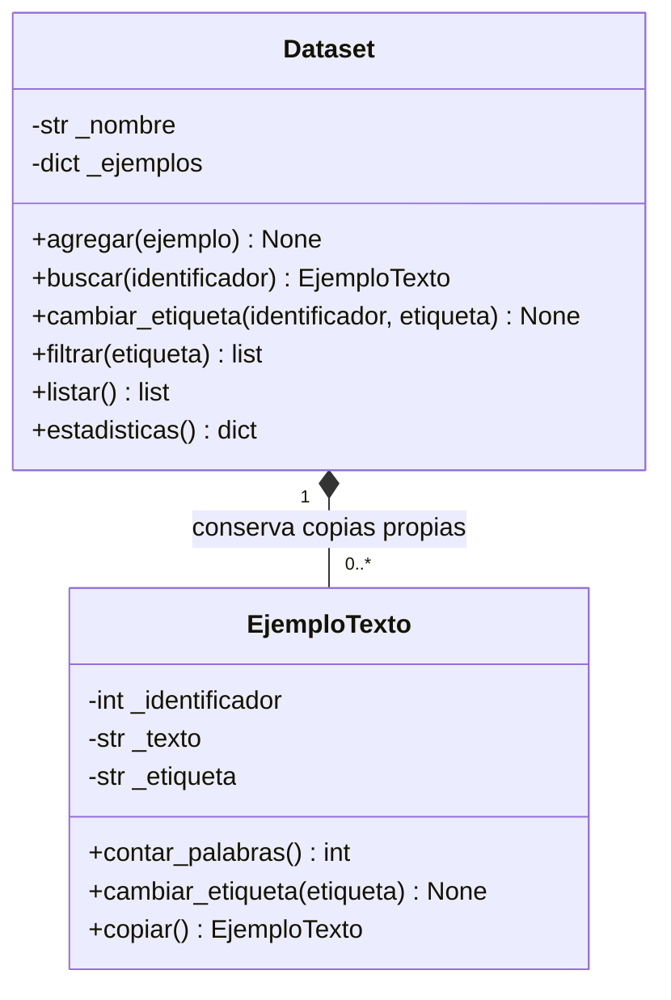

# Práctica 1 · Gestor de un conjunto de datos para IA

**Unidad:** UD2 · Fundamentos de POO aplicada a IA.  
**Modalidad:** individual, guiada al principio y autónoma en la ampliación.  
**Tiempo orientativo:** 3–4 horas.  
**Criterios:** RA2-a, b, c, e, f y RA5-c.

## 1. Situación de partida

Un equipo quiere organizar mensajes del aula antes de preparar un futuro
clasificador. Cada mensaje tiene una etiqueta asignada por una persona:
`consulta`, `incidencia` o `sugerencia`. Tu aplicación administrará estos ejemplos.
**No entrenarás un modelo** ni decidirás automáticamente la etiqueta.

Al finalizar podrás crear clases con un estado válido, organizar objetos en una
colección y responder a peticiones sin que una entrada incorrecta corrompa los datos.

### Para qué sirve la aplicación

Imagina que el centro dispone de mensajes que el alumnado ha enviado al aula virtual.
Antes de utilizar esos textos como ejemplos para un futuro sistema de IA, una persona
debe identificarlos, asignarles una categoría y revisar que el conjunto esté organizado.
Construirás una pequeña herramienta en memoria que permite realizar ese trabajo.
Su usuario sería la persona que prepara los datos: añade ejemplos, consulta uno por
su identificador, corrige una etiqueta y obtiene un resumen del conjunto.

Por ejemplo, registra el mensaje 2, «No funciona el acceso», como `incidencia`.
Al filtrar esa categoría aparecerá junto a los mensajes 5 y 8. Si una anotación
resulta incorrecta, puede corregirse sin cambiar el identificador ni el texto.
Con los diez ejemplos propuestos, el resumen inicial muestra 4 consultas,
3 incidencias y 3 sugerencias. Estos recuentos ayudan a detectar categorías poco
representadas, aunque por sí solos no garantizan la calidad de un futuro modelo.

**Recorrido de uso:** crear dataset → añadir textos ya etiquetados → consultar o
corregir → filtrar → revisar estadísticas. La aplicación no elige las etiquetas:
las recibe de una persona. Los datos viven durante la ejecución; esta práctica
no requiere base de datos, archivos persistentes ni una interfaz gráfica.

**Por qué varias clases:** un `EjemploTexto` sabe validar y describir un mensaje;
el `Dataset` sabe organizar muchos ejemplos y garantizar identificadores únicos.
Dos textos iguales con identificadores distintos son dos registros diferentes.

## 2. Modelo de análisis

### Vista UML de las clases

El rombo relleno representa **composición**: aquí se refiere a las copias internas
que posee cada dataset, no al objeto externo pasado a `agregar`. Cada copia interna
pertenece a un dataset y este puede estar vacío. El diagrama resume el estado interno;
las propiedades públicas de lectura se especifican en los requisitos. La composición
expresa propiedad lógica, no una orden de destrucción inmediata de objetos en Python.

### Responsabilidades y decisiones

Implementa estas dos clases. Un `Dataset` contiene **cero o más** `EjemploTexto`.
El mismo identificador puede existir en dos datasets distintos, pero no repetirse
dentro de uno. Cada instancia de `Dataset` tiene su propia colección.

| Clase | Estado | Operaciones públicas |
|---|---|---|
| `EjemploTexto` | Identificador entero, texto y etiqueta | Consultar atributos, contar palabras, cambiar etiqueta y copiar |
| `Dataset` | Nombre y colección de ejemplos | Agregar, buscar, cambiar una etiqueta, filtrar, listar y calcular estadísticas |

En el esquema UML que entregarás, usa `+` para operaciones públicas y `−` para
estado interno. En Python, `_atributo` expresa una convención de uso interno,
no un control de seguridad. Usa propiedades de lectura para consultar atributos.

## 3. Requisitos funcionales

### 3.1. EjemploTexto

- Constructor: `EjemploTexto(identificador, texto, etiqueta)`.
- El identificador será un `int` mayor que cero. `True` y `False` no se aceptan
  como identificadores aunque Python los relacione con `int`.
- El texto será `str`, sin espacios exteriores y con contenido. Se permiten
  textos repetidos si sus identificadores son distintos.
- La etiqueta se normaliza con minúsculas y eliminación de espacios exteriores.
  Solo se aceptan las tres etiquetas definidas.
- `contar_palabras()` devuelve el número de unidades separadas por espacios en
  blanco. `"El enlace está roto"` contiene cuatro. Para esta práctica, un signo
  pegado a una palabra no crea otra palabra.
- `cambiar_etiqueta(etiqueta)` valida el nuevo valor antes de modificar el estado.
- `copiar()` devuelve un objeto nuevo con los mismos valores.
- Expón `identificador`, `texto` y `etiqueta` como propiedades de lectura. La
  etiqueta se modifica mediante el método anterior.

### 3.2. Dataset

- Constructor: `Dataset(nombre)`. Nombre de texto no vacío.
- `agregar(ejemplo)` incorpora una **copia** del objeto. Rechaza un identificador
  duplicado en ese dataset. No reemplaza silenciosamente el ejemplo anterior.
- `buscar(identificador)` devuelve una copia del ejemplo encontrado.
- `cambiar_etiqueta(identificador, etiqueta)` cambia la etiqueta almacenada.
- `filtrar(etiqueta)` devuelve una lista de copias de los ejemplos coincidentes.
- `listar()` devuelve una lista de copias en el orden de inserción.
- `estadisticas()` devuelve un diccionario con `total`, `por_etiqueta`,
  `total_palabras` y `media_palabras`. El recuento incluye las tres etiquetas,
  incluso cuando alguna tiene cero ejemplos.
- Un dataset vacío tiene total 0, palabras 0 y media `0.0`.

La política de copias evita que cambiar un objeto que has añadido o consultado
modifique el dataset sin pasar por sus métodos. Elige y justifica una estructura
que permita buscar por identificador.

### 3.3. Errores

Usa `TypeError` para tipos incorrectos, `ValueError` para valores no permitidos
y `KeyError` para un identificador positivo que no existe al buscar o modificar.
La búsqueda también debe validar el tipo y la positividad del identificador.
La interfaz debe mostrar el error y permitir que continúe la demostración.

## 4. Datos de trabajo

| ID | Texto | Etiqueta |
|---:|---|---|
| 1 | Necesito los apuntes | consulta |
| 2 | No funciona el acceso | incidencia |
| 3 | Propongo más ejemplos | sugerencia |
| 4 | Cuándo entregamos la práctica | consulta |
| 5 | El enlace está roto | incidencia |
| 6 | Podemos grabar la explicación | sugerencia |
| 7 | Dónde está el material | consulta |
| 8 | No puedo abrir archivos | incidencia |
| 9 | Sugiero una tutoría grupal | sugerencia |
| 10 | Cuál es el horario | consulta |

## 5. Secuencia de trabajo

1. Dibuja el esquema de clases e identifica qué datos debe validar cada constructor.
2. Implementa `EjemploTexto` y comprueba un caso válido y uno inválido.
3. Implementa el almacenamiento, la inserción y la búsqueda de `Dataset`.
4. Añade modificación de etiquetas, filtrado y estadísticas.
5. Carga los diez mensajes y prepara una demostración que capture errores concretos.
6. Comprueba la independencia de dos datasets y de las copias devueltas.
7. Revisa nombres, sangría y docstrings. Explica los resultados sin limitarte a
   entregar capturas.

Puedes seguir el cuaderno `01_dataset_guiado.ipynb`. Cuando termines, reinícialo
y ejecuta todas las celdas para comprobar que no depende de ejecuciones anteriores.

## 6. Casos de aceptación

| Caso | Resultado esperado |
|---|---|
| Cargar los diez mensajes | 10 ejemplos: 4 consultas, 3 incidencias, 3 sugerencias |
| Calcular palabras | 38 palabras y media 3.8 |
| Filtrar `incidencia` | Identificadores 2, 5 y 8 |
| Buscar 4 | `Cuándo entregamos la práctica` |
| Añadir nuevamente el ID 1 | `ValueError`; se mantienen los diez ejemplos |
| Texto `"   "` o etiqueta `"spam"` | `ValueError` |
| ID `True` o texto `42` | `TypeError` |
| Buscar 999 | `KeyError` |
| Cambiar el ID 1 a `sugerencia` | 3 consultas, 3 incidencias, 4 sugerencias |
| Cambiar una copia devuelta por `buscar` | No cambia el ejemplo almacenado |
| Consultar un dataset vacío | Media 0.0, sin división por cero |

## 7. Entrega

- Proyecto Python ejecutable con clases separadas del código de demostración.
- `README.md` con instrucciones y una breve descripción de las decisiones.
- Esquema de clases y tabla de casos ejecutados con resultado obtenido.
- Si has usado el cuaderno: versión ejecutada de principio a fin.
- Respuestas a estas preguntas: ¿por qué no usar una lista de textos sin ID?
  ¿Qué diferencia hay entre asignar una referencia y copiar un objeto?
  ¿Por qué se valida la etiqueta antes de guardarla?

## 8. Evaluación sobre 10 puntos

| Aspecto | Puntos |
|---|---:|
| Clases, propiedades, constructores e independencia de instancias | 2 |
| Colección, inserción, búsqueda, filtrado y cambios de etiqueta | 3 |
| Estadísticas correctas, incluido el dataset vacío | 2 |
| Excepciones y conservación del estado ante fallos | 2 |
| Nombres, documentación interna y explicación de decisiones | 1 |

**Ampliación opcional:** añadir `eliminar(identificador)` con la misma política de
errores. No sustituye ningún requisito obligatorio ni exige guardar datos en disco.

**Lectura del UML:** `+` indica una operación pública y `-` estado interno.
En Python, el prefijo `_` es una convención, no una barrera de acceso.
Los bloques Mermaid se visualizan en un visor Markdown compatible; el texto y
las tablas mantienen la especificación completa si el visor muestra solo el código.
