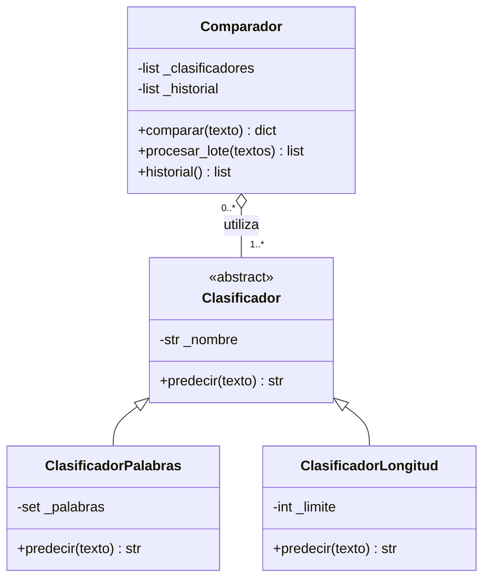

# Práctica 2 · Comparador de clasificadores de mensajes

**Unidad:** UD2. **Modalidad:** individual. **Tiempo:** 4–5 horas.  
**Criterios:** RA2-a–f y RA5-c.

## 1. Reto

Una aplicación necesita decidir qué mensajes conviene revisar. Se quieren comparar
dos estrategias sencillas sin reescribir el código que procesa el lote. Diseña
objetos intercambiables que respondan a una misma operación `predecir(texto)`.

Ambas estrategias son reglas didácticas. Una etiqueta `revisar` no demuestra que
el mensaje sea dañino y las discrepancias no son automáticamente fallos de código.

### Para qué sirve la aplicación

Imagina una bandeja de mensajes del aula que una persona quiere revisar. Se proponen
dos reglas para señalar mensajes: buscar palabras como `error` o `urgente`, y marcar
los que superen cierta longitud. Construirás una herramienta que aplica ambas reglas
al mismo texto y presenta sus resultados uno junto al otro. Su usuario puede estudiar
qué situaciones detecta cada estrategia y cómo influye cambiar su configuración.

Por ejemplo, con límite 3, «Error al iniciar» se marca como `revisar` por contener
`error`, pero es `normal` por longitud porque tiene exactamente tres palabras.
«una nota para ti» produce lo contrario: no contiene señales y supera el límite.
Si el límite pasa a 4, esa segunda regla devuelve `normal`. Así se observa que la
decisión depende de una regla concreta, no de una comprensión general del mensaje.

**Recorrido de uso:** configurar modelos → crear comparador → enviar textos →
obtener una fila por entrada → consultar el historial de comparaciones válidas.
Una entrada `42` genera una fila de error y no impide procesar el siguiente texto.
No se mide cuál modelo es más preciso: harían falta etiquetas de referencia y un
procedimiento de evaluación. `revisar` es una señal para una persona, no una prueba
de que exista un problema. Estas reglas son una simulación didáctica, sin entrenamiento.

**Por qué varias clases:** cada clasificador decide con su propia estrategia;
el comparador coordina las llamadas y guarda resultados. Añadir otra estrategia
que cumpla `predecir(texto)` no debe obligar a reescribir el comparador.

## 2. Clases y relaciones

### Vista UML de las clases

El triángulo apunta a la clase base: ambas hijas **son clasificadores**.
El rombo vacío indica **agregación**: el comparador recibe modelos que ya existen
y podrían compartirse. Cada comparador necesita uno o más modelos; un modelo puede
participar en cero o más comparadores. Se copia la lista exterior, no los modelos.
`predecir` es abstracto en la base; las hijas concretan la misma operación.

### Responsabilidades y decisiones

| Clase | Responsabilidad |
|---|---|
| `Clasificador` | Base abstracta con nombre de lectura y método abstracto `predecir` |
| `ClasificadorPalabras` | Especializa la base y busca señales completas |
| `ClasificadorLongitud` | Especializa la base y compara el número de palabras con un límite |
| `Comparador` | Recibe uno o más clasificadores, los invoca y conserva resultados |

El comparador **tiene** clasificadores. No hereda de ellos. Las dos estrategias
**son** clasificadores. No utilices un `if` por cada clase concreta dentro del
comparador: invoca la misma operación sobre cada objeto.

## 3. Contrato de entrada y salida

La normalización compartida debe:

1. Comprobar que la entrada es `str`.
2. Convertir a minúsculas.
3. Reemplazar cada signo de `string.punctuation`, además de `¿` y `¡`, por un espacio.
4. Separar por espacios en blanco y rechazar el resultado vacío.

Conserva tildes y números. Así, `"ERROR-al iniciar!"` contiene `error`, `al` e
`iniciar`. Este procedimiento es elemental: no trata todas las formas de
puntuación Unicode ni identifica raíces, plurales o sinónimos.

Cada `predecir(texto)` devolverá exactamente `"normal"` o `"revisar"`. Lanzará
`TypeError` si recibe otro tipo y `ValueError` si no quedan palabras.

## 4. Comportamiento obligatorio

### 4.1. ClasificadorPalabras

Constructor: `ClasificadorPalabras(palabras, nombre="palabras")`.

- Acepta una colección no vacía de señales: lista, tupla o conjunto.
- Cada señal será una cadena que, tras normalizar, contenga exactamente una palabra.
- Copia las señales a un conjunto interno.
- Devuelve `revisar` si al menos una palabra del mensaje coincide con una señal.
- No hace búsquedas de subcadenas: `fallo` no coincide con `fallos`.

### 4.2. ClasificadorLongitud

Constructor: `ClasificadorLongitud(limite=3, nombre="longitud")`.

- El límite será un entero positivo. No se aceptan booleanos.
- Devuelve `revisar` si el número de palabras es **mayor** que el límite.
- Un mensaje con exactamente tres palabras es normal para el límite 3.

Ambos nombres deben ser cadenas no vacías. Podrás proporcionar otros nombres
para comparar, por ejemplo, dos modelos de longitud con límites diferentes.

### 4.3. Comparador

Constructor: `Comparador(clasificadores)`, con lista o tupla no vacía de objetos
que hereden de `Clasificador`. Exige nombres únicos y copia la colección exterior.

- `comparar(texto)` devuelve un diccionario `{nombre: etiqueta}`.
- Solo incorpora la comparación al historial si **todos** los clasificadores
  producen una etiqueta válida. Un resultado distinto de las dos etiquetas
  permitidas incumple el contrato y produce `ValueError`.
- `procesar_lote(textos)` acepta lista o tupla y devuelve una fila por entrada,
  con `posicion` (desde 1), `entrada` (`repr` del dato), `resultados` y `error`.
- Ante `TypeError` o `ValueError`, la fila tendrá `resultados=None` y un mensaje
  de error. El proceso continúa con la siguiente entrada.
- Las entradas rechazadas no se guardan en el historial de comparaciones válidas.
- `historial()` devuelve copias de sus filas y de los diccionarios de resultados.
- Un lote vacío devuelve `[]`. Cada comparador posee un historial independiente.

## 5. Experimento y resultados esperados

Usa las señales `urgente`, `error` y `fallo`, con límite 3.

| Mensaje | Por palabras | Por longitud |
|---|---|---|
| `hola` | normal | normal |
| `Error al iniciar` | revisar | normal |
| `URGENTE!` | revisar | normal |
| `una nota para ti` | normal | revisar |
| `fallo` | revisar | normal |
| `sin fallos` | normal | normal |
| `uno dos tres` | normal | normal |
| `urgente urgente urgente urgente` | revisar | revisar |
| Cadena vacía | rechazo | rechazo |
| Entero `42` | rechazo | rechazo |

El informe tendrá diez filas. El historial tendrá ocho comparaciones válidas.
Cambiar el límite a 4 convierte `una nota para ti` en normal por longitud.

## 6. Plan de trabajo

1. Define el contrato y dibuja el esquema de herencia y colaboración.
2. Implementa y comprueba la función de normalización compartida.
3. Construye la base abstracta y las dos clases hijas.
4. Implementa el comparador sin distinguir clases concretas.
5. Añade recuperación por registro y protección del historial mediante copias.
6. Ejecuta los diez casos y comprueba también límite 0, señales vacías y nombres repetidos.

## 7. Entrega y defensa

Entrega proyecto ejecutable, esquema de clases, instrucciones y tabla de
resultados. Explica por qué `sin fallos` no coincide con `fallo`, por qué el empate
con el límite usa `normal` y por qué una diferencia entre modelos no basta para
medir cuál es mejor. No calcules exactitud si no dispones de etiquetas de referencia.

## 8. Evaluación sobre 10 puntos

| Aspecto | Puntos |
|---|---:|
| Contrato abstracto, herencia y polimorfismo real | 3 |
| Normalización y reglas de los dos clasificadores | 2 |
| Comparador, lote e historial independiente | 2 |
| Excepciones y resultados consistentes ante fallos | 2 |
| Legibilidad, documentación y explicación del experimento | 1 |

**Ampliación opcional:** incorpora un tercer clasificador que siempre devuelva
`normal`, respetando la validación de entrada. El comparador debe funcionar sin
modificaciones. No necesitas instalar bibliotecas de aprendizaje automático.

**Lectura del UML:** `+` indica una operación pública y `-` estado interno.
En Python, el prefijo `_` es una convención, no una barrera de acceso.
Los bloques Mermaid se visualizan en un visor Markdown compatible; el texto y
las tablas mantienen la especificación completa si el visor muestra solo el código.
