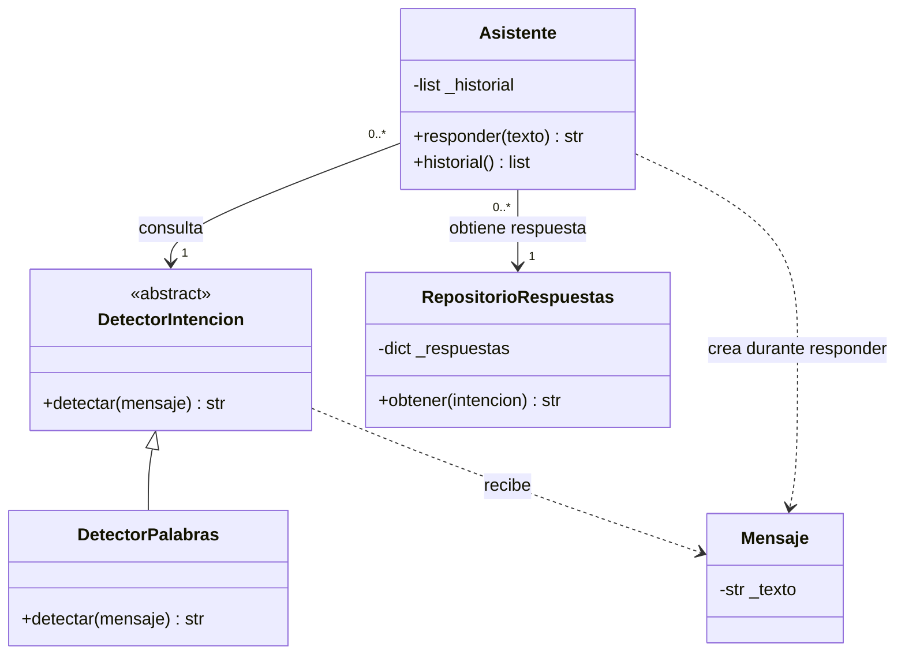
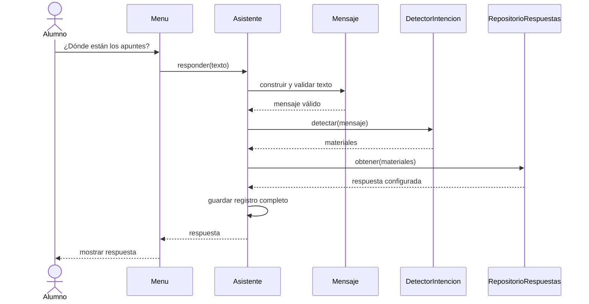

# Práctica 3 · Asistente de atención al alumnado basado en reglas

**Unidad:** UD2. **Modalidad:** individual. **Tiempo:** 5–6 horas.  
**Criterios:** RA2-a–f y RA5-c.

## 1. Situación

Construye un asistente de consola que responda a consultas sobre entregas,
horarios y materiales. Los objetos deben colaborar mediante métodos y cada
conversación debe conservar su historial de forma independiente.

El asistente selecciona respuestas predefinidas. No es un modelo generativo ni
comprende el lenguaje como una persona. Usa información ficticia en la demostración
y señálala como tal. No incluyas datos personales reales.

### Para qué sirve la aplicación

Imagina un servicio de consulta rápida del aula virtual. El alumnado escribe una
pregunta sobre entregas, horarios o materiales, y el programa selecciona una respuesta
ya preparada. Construirás un asistente de consola para practicar cómo varios objetos
cooperan: recibir un mensaje, detectar el tema, buscar la respuesta y guardar el intercambio.
Cada objeto `Asistente` representa una conversación independiente.

Por ejemplo, ante «¿Dónde están los apuntes?», el detector encuentra `apuntes`,
elige `materiales` y el repositorio devuelve «Ejemplo didáctico: los apuntes están
en la sección Materiales». Si se escribe «hola», la entrada es válida, pero no
hay señales: se responde con la ayuda de `desconocida` y se guarda el intercambio.
Si se introduce `!!!`, no hay palabras; se muestra un error y el historial no crece.

**Recorrido de uso:** elegir enviar mensaje → escribir consulta → recibir respuesta
→ consultar historial → enviar otra consulta o salir. Todas las respuestas de la
demostración son ficticias. No se consulta información real del centro ni se generan
respuestas nuevas. La detección por palabras puede equivocarse: «no pregunto por el
horario» contiene `horario` y activa esa categoría porque no se interpreta la negación.

**Por qué varias clases:** el mensaje valida la entrada; el detector identifica
una intención; el repositorio contiene las respuestas; el asistente coordina el
proceso. Cambiar la redacción de una respuesta no exige modificar la detección.

## 2. Diseño requerido

### Vista UML de las clases

Cada asistente necesita **exactamente un** detector y un repositorio. Ambos pueden
compartirse entre varias conversaciones; el historial se crea por instancia y no
se comparte. La flecha discontinua expresa una dependencia temporal: `Mensaje`
se crea para procesar la consulta. El historial conserva diccionarios de cadenas,
no una colección de objetos `Mensaje`. `DetectorPalabras` concreta el contrato abstracto.

### Responsabilidades y decisiones

| Clase | Responsabilidad y operaciones |
|---|---|
| `Mensaje` | Valida el texto y lo expone mediante una propiedad de lectura |
| `DetectorIntencion` | Clase abstracta con `detectar(mensaje)` |
| `DetectorPalabras` | Implementa la detección por señales y resuelve empates |
| `RepositorioRespuestas` | Recibe un diccionario y ofrece `obtener(intencion)` |
| `Asistente` | Recibe detector y repositorio, implementa `responder(texto)` e `historial()` |

Un asistente tiene exactamente un detector, un repositorio y cero o más registros.
Dos asistentes pueden compartir detector y repositorio, pero no deben compartir
su lista de historial. `DetectorPalabras` hereda de `DetectorIntencion`.

## 3. Reglas de detección

Reutiliza la normalización de la práctica 2: minúsculas, puntuación ASCII y `¿¡`
convertidas en espacios, separación por espacios en blanco y rechazo de entradas
sin palabras. Conserva tildes. `Mensaje` guarda el texto original sin espacios
exteriores; la normalización se usa para analizarlo.

| Intención | Palabras clave |
|---|---|
| entregas | entrega, entregas, entregamos, plazo, práctica, practica |
| horarios | horario, horarios, hora, clase, clases |
| materiales | material, materiales, apuntes, libro, recursos |

La cuarta intención es `desconocida`, utilizada cuando ninguna categoría coincide.

**Algoritmo obligatorio:** cuenta las señales **distintas** encontradas en cada
categoría. Gana el mayor número de coincidencias. Repetir una palabra no suma
otra coincidencia. Ante empate positivo, aplica el orden `entregas`, `horarios`,
`materiales`. Si todas tienen cero, el resultado es `desconocida`.

Por ejemplo, `hora de entrega` empata y gana entregas. En `hora clase entrega`,
horarios obtiene dos señales y gana a entregas, que tiene una. Esta prioridad
es una decisión del ejercicio y debe quedar documentada.

## 4. Respuestas y coordinación

- `RepositorioRespuestas` recibe exactamente las cuatro claves admitidas, con
  respuestas `str` no vacías. Copia el diccionario para aislar su configuración.
- `obtener` rechaza una intención fuera del contrato. No la convierte
  silenciosamente en `desconocida`, porque podría ocultar un fallo del detector.
- `Asistente.responder(texto)` crea un `Mensaje`, llama al detector, solicita la
  respuesta al repositorio y la devuelve como `str`.
- Tras completar esas operaciones, añade un registro con `texto`, `intencion`
  y `respuesta`. Si algo falla, no añade registros parciales.
- Una consulta válida pero desconocida **sí** se guarda en el historial.
- `historial()` devuelve una lista nueva con una copia de cada diccionario.

Puedes usar estas respuestas ficticias:

- Entregas: «Ejemplo didáctico: la entrega se realiza en la tarea del aula virtual».
- Horarios: «Ejemplo didáctico: consulta el horario publicado en el aula virtual».
- Materiales: «Ejemplo didáctico: los apuntes están en la sección Materiales».
- Desconocida: «No reconozco la consulta. Pregunta por entregas, horarios o materiales».

### Secuencia de una consulta

La secuencia representa el camino correcto. Si la construcción de `Mensaje`
falla, no se llama al detector ni al repositorio y no se guarda nada. Si un
colaborador falla después, tampoco se guarda un registro parcial: el menú captura
los errores de entrada previstos y permite continuar.

## 5. Interfaz de consola y errores

Implementa un menú en bucle: `1. Enviar mensaje`, `2. Ver historial`, `0. Salir`.
Una opción desconocida debe mostrar un aviso y volver al menú. El historial vacío
debe indicarse. Captura los errores de entrada para continuar la conversación.

Usa `TypeError` para tipos incorrectos y `ValueError` para valores inválidos.
Los constructores de `Asistente` deben comprobar sus colaboradores. Las clases
del dominio no deben usar `input()` ni `print()`: esas operaciones pertenecen
a la función del menú y a la demostración.

## 6. Comprobaciones mínimas

| Entrada o situación | Resultado esperado |
|---|---|
| `¿Cuándo entregamos la práctica?` | entregas |
| `¿Dónde están los apuntes?` | materiales |
| `hora de entrega` | entregas por desempate |
| `hora clase entrega` | horarios, por mayor puntuación |
| `hora hora entrega` | entregas: repetir hora no suma |
| `hola` | desconocida y respuesta de ayuda |
| `!!!`, `"   "` o `""` | `ValueError`, sin registro |
| `42` | `TypeError`, sin registro |
| Diccionario sin respuesta para desconocida | `ValueError` al construir el repositorio |
| Dos asistentes recién creados | Ambos historiales vacíos e independientes |
| Enviar un mensaje al primero | El historial del segundo continúa vacío |
| Modificar una fila de la copia del historial | El historial real permanece intacto |

## 7. Desarrollo y entrega

1. Dibuja las clases y la secuencia de llamadas de `responder`.
2. Implementa `Mensaje`, la interfaz y el detector. Comprueba los empates.
3. Implementa el repositorio y sus validaciones.
4. Construye el asistente y comprueba la independencia entre conversaciones.
5. Añade el menú y realiza una conversación con al menos seis intentos, uno inválido.
6. Entrega proyecto, instrucciones, diagramas y tabla de pruebas. Incluye una
   explicación de las limitaciones y de cómo conectarías otro detector que
   respetase el mismo contrato, sin tener que implementarlo.

## 8. Evaluación sobre 10 puntos

| Aspecto | Puntos |
|---|---:|
| Responsabilidades, contrato, herencia y composición | 3 |
| Detección, normalización y desempates | 2 |
| Repositorio e historial independiente y protegido | 2 |
| Menú, excepciones y continuidad tras errores | 2 |
| Legibilidad, documentación y explicación del diseño | 1 |

**Ampliación opcional:** añade un detector alternativo sencillo que respete el
contrato. El asistente debe admitirlo sin cambiar su método `responder`.

**Lectura del UML:** `+` indica una operación pública y `-` estado interno.
En Python, el prefijo `_` es una convención, no una barrera de acceso.
Los bloques Mermaid se visualizan en un visor Markdown compatible; el texto y
las tablas mantienen la especificación completa si el visor muestra solo el código.
